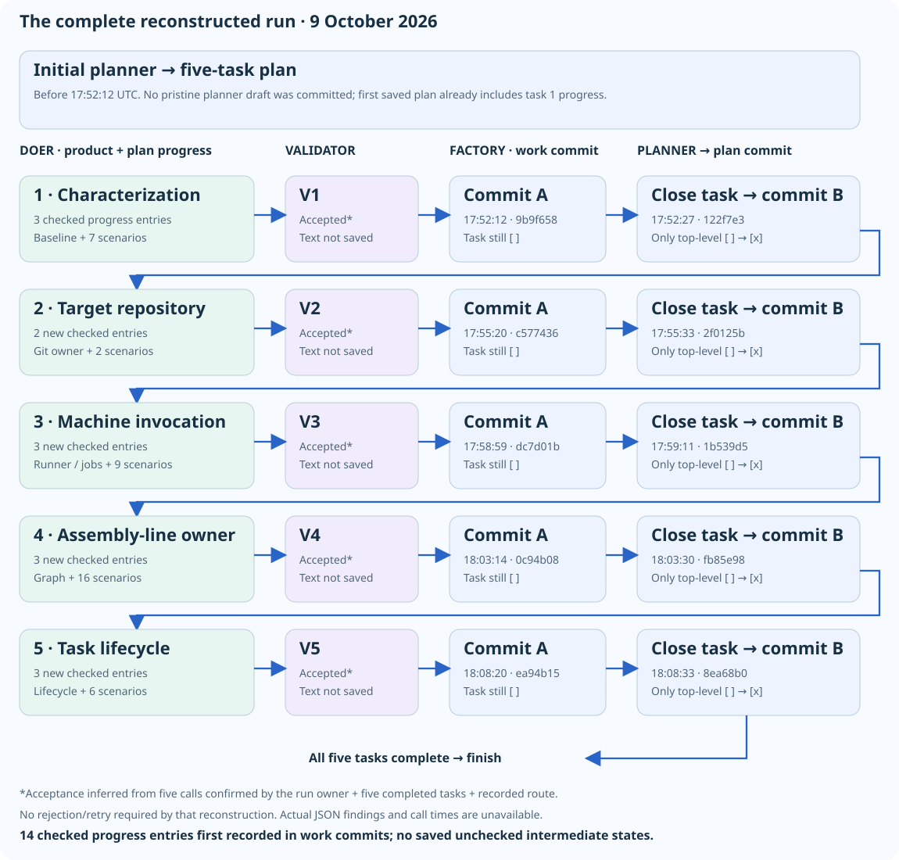

# Tutor note: what did the validator actually do?

**The confusion:** this factory refactoring run completed five tasks and produced checked subtasks. The validator was called five times. **Were those subtasks its feedback, and what did it actually review?**

**Git’s answer:** the subtasks appear to be doer progress notes. The validator accepted each task under the recorded workflow, but its actual feedback was not retained in the available evidence.

## What happened

The seed committed at **17:43:36 UTC on 9 October 2026** was:

```text
Refactor the factory.
Your lens is validator-lens.md
```

**Command-line context (confirmed by the run owner):** `factory/validator-lens.md` was also used as a seed in the command line, so the design guidance was supplied directly—not merely referenced by the committed refactoring seed.

The planner produced five tasks. For each, the reconstructed sequence is:

**Doer implements and records progress → validator accepts → factory commits work → planner marks task done → factory commits that checkbox.**

| Task | Checked progress entries first saved | Work commit (UTC) | Planner closes task |
| --- | --- | --- | --- |
| Characterization tests | 3: baseline, coverage, behavior preservation | `9b9f658` · 17:52:12 | `122f7e3` · 17:52:27 |
| Target Git owner | 2: extraction, tests/results | `c577436` · 17:55:20 | `2f0125b` · 17:55:33 |
| Machine execution/prompts | 3: extraction, coverage, verification | `dc7d01b` · 17:58:59 | `1b539d5` · 17:59:11 |
| Assembly-line owner | 3: extraction, coverage, verification | `0c94b08` · 18:03:14 | `fb85e98` · 18:03:30 |
| Task lifecycle | 3: extraction, coverage, verification | `ea94b15` · 18:08:20 | `8ea68b0` · 18:08:33 |

All five completion commits change **only the top-level checkbox**. The last closes the plan; the normal route then finishes.

## Who created the subtasks—and when?

**Fourteen checked progress entries** first appear in the work commits, already marked done. Their implementation/testing content and the role instructions point to the **doer**, during each task’s work—not the validator or the subsequent planner completion.

For tasks 2–5, Git explicitly shows these entries being inserted into the existing plan. Task 1 is less certain: its entries arrive with the first saved plan, so the initial planner draft and first-doer edits cannot be separated.

Git gives their first saved times, **not their exact creation times**. No committed version shows these entries unchecked. They are not identified as validator findings.

## What did the five validations say?

- **Decision:** the run owner confirms five calls. With five completed tasks and the committed validator-gated route, that implies one acceptance per task, without retries—assuming that configuration was used.
- **Comments/findings:** unknown. No matching review transcript or console capture was found. The factory printed results to stdout; Git did not retain them.
- **Important trap:** “no previous validator findings were supplied” in later doer notes does **not** prove empty reviews. The factory resets findings between tasks. An accepted response could also contain nonempty findings.

So we can reconstruct **acceptance**, but cannot quote the feedback or judge its depth.

## Two questions for the tutor

1. **Which lens should have governed review?** The seed requests the responsibility-driven design file `validator-lens.md`, but the committed validator configuration says `testability`. Did the validator reconcile these, and should its selected lens and rationale be recorded?
2. **What evidence should acceptance leave?** Tests improved to **40 passing scenarios**, but **45 inherited scenarios stayed undefined**, so the full suite still exited 1. Did the validator explicitly accept preservation of that baseline? Without its feedback, we cannot tell.

This is **not evidence that the validator did nothing**. Its decisions gated completion; its reasoning is the missing part.



## Evidence

[Plan](../factory/.factory/plan.md) · [Baseline](../factory/src/test/REFACTORING-BASELINE.md) · [Run diff](https://github.com/rwestgeest/libby/compare/643e667e830f8c4e03de49bcd8a182ac707ffcac...8ea68b04ba670793009b11360f06b7df14e05b4c)

```sh
git log --reverse -p 643e667..8ea68b0 -- factory/.factory/plan.md
git show 643e667:factory/src/main/kotlin/Main.kt
```

The seed text was recovered; the exact initiating chat/launch command was not. Historical objects were inspected through `0606af3`; no historical test rerun was performed.

[HTML version](2026-10-09-factory-refactoring-run-explained.html).
