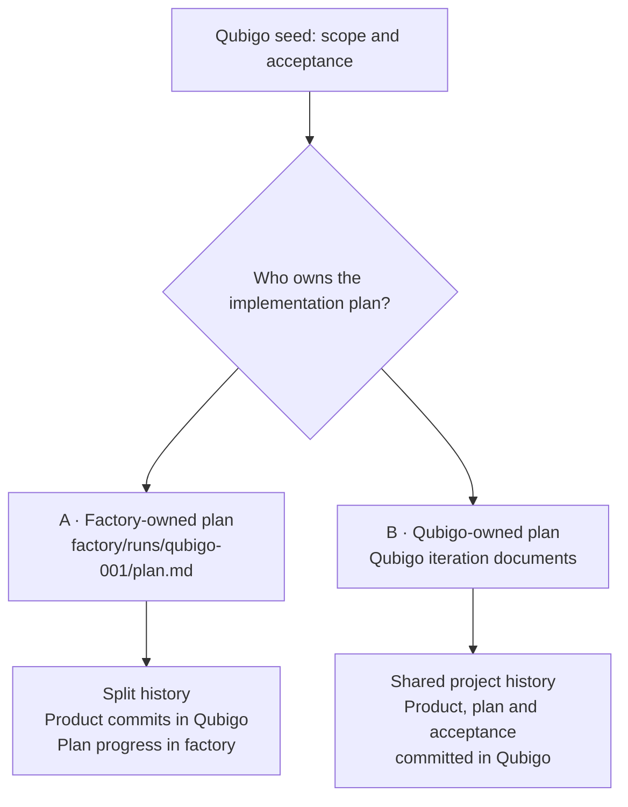

# Where should a factory run's plan live?

The Qubigo run exposed a puzzle: **the factory spec puts the implementation plan outside Qubigo, but agents are told to work only inside Qubigo.** Agents wrote a target-local plan instead; the factory kept supplying the missing external path.

This is also an ownership question. Qubigo contains commits for the implemented work, but a factory-owned plan leaves task progress and acceptance decisions detached from that history. Manual acceptance concerns Qubigo, yet completing it would require updating factory-owned state.

| | A — Keep the current spec | B — Make the plan target-owned |
| --- | --- | --- |
| Required change | Permit planner/doer to update the exact external plan; verify it exists before implementation. | Change spec and code to use a consistent target-local path, distinct per run. |
| Ownership | Factory stores the run's implementation progress. | Qubigo stores its implementation progress; factory manages execution. |
| Reconstructing work | Correlate Qubigo commits with separately preserved plan history. Current target commits do not capture the external plan. | Commit plan updates at defined task boundaries so work and progress can be followed together. |
| Manual acceptance | Record Qubigo acceptance in the factory-owned plan, potentially linking target-local evidence. | Record evidence and acceptance progress in Qubigo; planner uses that evidence when resuming. |
| Tradeoff | Keeps run state outside the product repository, but splits the work record across repositories. | Keeps the work record together, but adds process documents and requires rules for their commits and validation. |

**Suggested direction: B.** The factory owns execution; Qubigo owns the work record. A fixes the immediate prompt contradiction, but retains the historical and acceptance ownership problems. B is a proposed contract change, not the current specification.

Neither alternative alone reconstructs every agent attempt: saved prompts, results and routing decisions are also needed, linked to relevant product commits. Neither resolves outstanding real-device acceptance; those checks still need to be performed and recorded.

Sources: [run explanation](2026-10-11-qubigo-factory-run-explained.md), [plan ownership spec](../factory/spec/features/planning.feature), [agent prompts](../factory/src/main/kotlin/MachineJobs.kt), [target commit handling](../factory/src/main/kotlin/TargetRepository.kt). No factory changes are included in this analysis.
