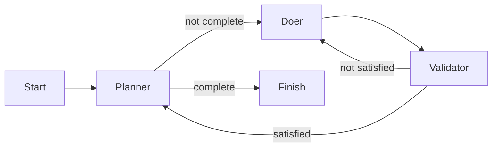

# Qubigo factory run: locations, workflow, and current state

Recorded on 2026-10-11. This describes the inspected state, not a live status dashboard.

## Three layers

The factory runs the process, Qubigo defines the workflow, and the iteration documents define the work.

| Location | Purpose |
| --- | --- |
| `factory/` | Factory program: invokes agents, follows workflow routes, handles commits and retries. |
| `factory/.factory/plan.md` | A plan for refactoring the factory itself. Unrelated to Qubigo iteration 001. |
| `factory/runs/qubigo-001/settings.json` | Connects the named run to its target repository, iteration specification, and `careful` assembly line. |
| `qubigo/.assembly-lines/careful.dot` | Defines routing between planner, doer, and validator. The directory is `.assembly-lines`, plural. |
| `qubigo/.assembly-lines/.machines/` | Configures agents. All use `pi`; the validator has the `testability` lens. |
| `qubigo/docs/iterations/001-clickable-app-banner.md` | Agreed product scope and acceptance criteria, called the seed by the factory. |
| `qubigo/docs/iterations/001-clickable-app-banner-plan.md` | Agent-created implementation tasks and progress, currently in a workaround location. |
| `qubigo/docs/iterations/001-clickable-app-banner-validation.md` | Execution evidence, test results, validator findings, and outstanding manual checks. |
| `qubigo/docs/iterations/001-clickable-app-banner-baseline/` | Raw command outputs before implementation. |
| `qubigo/docs/iterations/001-clickable-app-banner-verification/` | Raw command outputs after implementation. |

## How the run connects them

Paths below are relative to `/home/rob/dev/libby` unless absolute:

```text
factory run: qubigo-001
  target -> /home/rob/dev/libby/qubigo
         -> /home/rob/dev/qubigo (symlink)
  seed   -> qubigo/docs/iterations/001-clickable-app-banner.md
  line   -> qubigo/.assembly-lines/careful.dot
  plan   -> factory/runs/qubigo-001/plan.md
```

The settings persist the target, seed, and line. The factory derives the run plan location. Subsequent invocations can supply only the run name; the stored settings are immutable.

The seed states what the product owner wants and how the outcome will be accepted. The planner creates an implementation plan from that seed. The factory treats plan contents as agent-owned rather than parsing the task list itself.

## Workflow and commits



The doer implements the first unfinished task. Validator findings return to the doer and are recorded as subtasks of that task. Retries are bounded by the factory's attempt limit.

After validation succeeds, the factory commits the task changes, then asks the planner to mark the task done. It records the planner's updates as well. The validator reviews only the current uncommitted changes, including new files; it does not recheck previously committed product work.

## Latest recorded Qubigo state

Tasks 1–4 are marked complete in the target-local implementation plan:

1. Establish baseline checks.
2. Implement the banner link and regression coverage.
3. Add local styling and accessibility affordances.
4. Run automated verification and record evidence.

The focused banner suite passes all 18 tests and the production build passes. Full tests and lint reproduce documented pre-existing failures. Those unrelated failures were left outside this iteration.

Task 5, manual acceptance and handoff, remains unfinished for two reasons.

### Expected plan is missing

The factory supplies `/home/rob/dev/libby/factory/runs/qubigo-001/plan.md`, but agents are also instructed to work only inside the Qubigo target. They wrote the implementation plan under `qubigo/docs/iterations/` instead. The factory continues supplying the original nonexistent path, so validators report `ENOENT`.

The target-local document is a workaround, not a repair of the factory contract. The factory should either permit agents to update the run-owned plan or formally use a target-local plan path consistently. This is a recommendation, not an implemented change.

### Manual acceptance requires devices

Real iPhone/iPad layout, accessibility, dismissal, and App Store handoff checks have not been executed. The available environment lacked the required runtime/device access. The validation document contains an outstanding acceptance matrix rather than fabricated passing results.

These are distinct blockers: repairing the plan path will not complete real-device acceptance.

## What counts as the log here

No saved Qubigo factory console log was found during inspection. `factory/target/test.log` is output from the factory's own test suite, not the Qubigo production run.

This explanation reconstructs the latest recorded run state from the Qubigo implementation plan and validation evidence, checked against run settings, assembly-line configuration, and factory source (`MachineJobs.kt`, `TaskLifecycle.kt`, and `NamedRun.kt`). Historical execution notes can say a task is still in progress even where the planner later marked it done; use the latest plan status together with the latest validation section.

No deployment or app-store release is recorded as part of this iteration.
