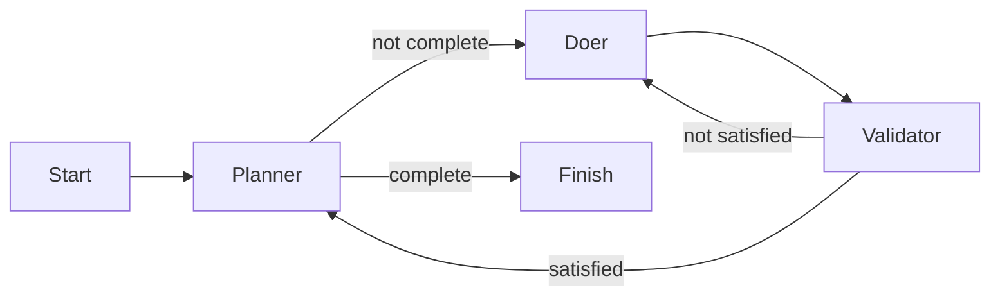

# Qubigo factory run: locations, workflow, and current state

Recorded on 2026-10-11. This describes the inspected state, not a live status dashboard.

## Three layers

The factory runs the process, Qubigo defines the workflow, and the iteration documents define the work.

| Location | Purpose |
| --- | --- |
| [`factory/`](/factory/) | Factory program: invokes agents, follows workflow routes, handles commits and retries. |
| [`factory/.factory/plan.md`](/factory/.factory/plan.md) | A plan for refactoring the factory itself. Unrelated to Qubigo iteration 001. |
| [`factory/runs/qubigo-001/settings.json`](/factory/runs/qubigo-001/settings.json) | Connects the named run to its target repository, iteration specification, and `careful` assembly line. |
| [`qubigo/.assembly-lines/careful.dot`](/qubigo/.assembly-lines/careful.dot) | Defines routing between planner, doer, and validator. The directory is `.assembly-lines`, plural. |
| [`qubigo/.assembly-lines/.machines/`](/qubigo/.assembly-lines/.machines/) | Configures agents. All use `pi`; the validator has the `testability` lens. |
| [`qubigo/docs/iterations/001-clickable-app-banner.md`](/qubigo/docs/iterations/001-clickable-app-banner.md) | Agreed product scope and acceptance criteria, called the seed by the factory. |
| [`qubigo/docs/iterations/001-clickable-app-banner-plan.md`](/qubigo/docs/iterations/001-clickable-app-banner-plan.md) | Agent-created implementation tasks and progress, currently in a workaround location. |
| [`qubigo/docs/iterations/001-clickable-app-banner-validation.md`](/qubigo/docs/iterations/001-clickable-app-banner-validation.md) | Execution evidence, test results, validator findings, and outstanding manual checks. |
| [`qubigo/docs/iterations/001-clickable-app-banner-baseline/`](/qubigo/docs/iterations/001-clickable-app-banner-baseline/) | Raw command outputs before implementation. |
| [`qubigo/docs/iterations/001-clickable-app-banner-verification/`](/qubigo/docs/iterations/001-clickable-app-banner-verification/) | Raw command outputs after implementation. |

## How the run connects them

Paths below are relative to `/home/rob/dev/libby` unless absolute:

```text
factory run: qubigo-001
  target -> /home/rob/dev/libby/qubigo
         -> /home/rob/dev/qubigo (symlink)
  seed   -> qubigo/docs/iterations/001-clickable-app-banner.md
  line   -> qubigo/.assembly-lines/careful.dot
  plan   -> factory/runs/qubigo-001/plan.md
```

The settings persist the target, seed, and line. The factory derives the run plan location. Subsequent invocations can supply only the run name; the stored settings are immutable.

The seed states what the product owner wants and how the outcome will be accepted. The planner creates an implementation plan from that seed. The factory treats plan contents as agent-owned rather than parsing the task list itself.

## Workflow and commits



The doer implements the first unfinished task. Validator findings return to the doer and are recorded as subtasks of that task. Retries are bounded by the factory's attempt limit.

After validation succeeds, the factory commits the task changes, then asks the planner to mark the task done. It records the planner's updates as well. The validator reviews only the current uncommitted changes, including new files; it does not recheck previously committed product work.

## Who creates the evidence files and chooses their names?

The `.txt` files contain output from test, lint, and build commands that the agent saved as evidence. The factory does not define these filenames or create these evidence folders. The seed requires checks and recorded evidence; the agent chooses how to organize that evidence, and the plan records the chosen locations for subsequent work.

Both `001-clickable-app-banner-baseline/` and `001-clickable-app-banner-verification/` contain the same four filenames:

| Filename | Command whose output it records |
| --- | --- |
| `focused-tests.txt` | `npm test -- --runInBand test/components/app-banner-component.test.js` |
| `full-tests.txt` | `npm test -- --runInBand` |
| `lint.txt` | `npm run lint` |
| `build.txt` | `npm run build` |

The baseline folder records checks before application changes; the verification folder records checks afterward. This comparison lets the reviewer distinguish existing failures from regressions. These names are an agent-created convention for this iteration, not a factory artifact format guaranteed for every run. The saved records establish the commands and results; without a saved execution transcript, they do not establish the exact shell redirection or file-writing operation used to capture each log.

### What is deterministic, and what involves agent judgment?

| Part | Who controls it? |
| --- | --- |
| Seed and plan paths supplied to machines | Factory code and run configuration. The historical plan-path problem is described below. |
| Workflow routes, retry limit, and commit boundaries | Factory code and the selected assembly line. Routing follows the machines' returned result fields. |
| Instruction to implement the first unfinished task | Factory prompt. The agent reads and interprets the plan; the factory does not parse its task list. |
| Task breakdown, evidence filenames, and Markdown organization | Agent judgment, subject to the seed and any existing plan instructions. |
| Test, lint, and build output | The invoked tools. Timing, environment, and asynchronous behaviour can make output vary between runs. |
| Validator assessment and wording of findings | Agent judgment under the configured validation lens. |
| Passing returned findings into the next doer prompt | Factory code. |

The factory provides fixed orchestration rules; those rules operate on decisions and documents produced by agents. An evidence filename can become a stable instruction once recorded in the plan without having been hard-coded in the factory.

## How validation becomes work for the doer

There is no `verification.md` in these artifacts: `…-verification/` is the raw-output folder, and `…-validation.md` is the Markdown evidence report. The factory does not parse that report into tasks or automatically feed its contents back to the doer.

The feedback channel is the validator's JSON result. For example:

```json
{"satisfied": false, "findings": ["Real-device acceptance evidence is missing."]}
```

The factory extracts the `findings` array and includes it in the next doer prompt. The prompt says:

```text
Implement the first unfinished task in the plan.
Validator findings from the previous attempt: [...]
Record each finding as a subtask of the task in progress, then fix it.
Mark resolved subtasks done. Do not create new top-level tasks for findings.
Do not mark the task itself done; the planner will do that after the work is committed.
```

This mechanism is implemented in [`MachineJobs.kt`](/factory/src/main/kotlin/MachineJobs.kt) and [`TaskLifecycle.kt`](/factory/src/main/kotlin/TaskLifecycle.kt). Findings are retained for retries within the task and reset after the planner executes.

The documents therefore have distinct roles:

- **Implementation plan:** the doer's work list, including subtasks recorded from validator findings.
- **Validation Markdown:** the agent's execution journal, evidence summary, and outstanding manual acceptance matrix. The agent may consult and update it while following the plan.
- **Validator JSON findings:** the feedback the factory explicitly forwards into the next doer attempt.
- **Raw `.txt` logs:** supporting command output that agents and reviewers can inspect.

The manual acceptance matrix contains actionable checks, but it is not a separate task queue consumed by the factory. Task 5 in the plan directs the doer to perform those checks and record evidence. A missing check can consequently appear in the evidence report, in a validator finding, and as a plan subtask: the same issue is being documented, communicated, and tracked in three places.

## Latest recorded Qubigo state

Tasks 1–4 are marked complete in the target-local implementation plan:

1. Establish baseline checks.
2. Implement the banner link and regression coverage.
3. Add local styling and accessibility affordances.
4. Run automated verification and record evidence.

The focused banner suite passes all 18 tests and the production build passes. Full tests and lint reproduce documented pre-existing failures. Those unrelated failures were left outside this iteration.

Task 5, manual acceptance and handoff, remains unfinished for two reasons.

### Expected plan is missing

The factory supplies [`/home/rob/dev/libby/factory/runs/qubigo-001/plan.md`](/factory/runs/qubigo-001/plan.md), but agents are also instructed to work only inside the Qubigo target. They wrote the implementation plan under [`qubigo/docs/iterations/`](/qubigo/docs/iterations/) instead. The factory continues supplying the original nonexistent path, so validators report `ENOENT`.

The target-local document ([`qubigo/docs/iterations/001-clickable-app-banner-plan.md`](/qubigo/docs/iterations/001-clickable-app-banner-plan.md)) is a workaround, not a repair of the factory contract. The factory should either permit agents to update the run-owned plan or formally use a target-local plan path consistently. This is a recommendation, not an implemented change.

### Manual acceptance requires devices

Real iPhone/iPad layout, accessibility, dismissal, and App Store handoff checks have not been executed. The available environment lacked the required runtime/device access. The validation document contains an outstanding acceptance matrix rather than fabricated passing results.

These are distinct blockers: repairing the plan path will not complete real-device acceptance.

## What counts as the log here

No saved Qubigo factory console log was found during inspection. [`factory/target/test.log`](/factory/target/test.log) is output from the factory's own test suite, not the Qubigo production run.

This explanation reconstructs the latest recorded run state from the Qubigo implementation plan and validation evidence, checked against run settings, assembly-line configuration, and factory source ([`MachineJobs.kt`](/factory/src/main/kotlin/MachineJobs.kt), [`TaskLifecycle.kt`](/factory/src/main/kotlin/TaskLifecycle.kt), and [`NamedRun.kt`](/factory/src/main/kotlin/NamedRun.kt)). Historical execution notes can say a task is still in progress even where the planner later marked it done; use the latest plan status together with the latest validation section.

No deployment or app-store release is recorded as part of this iteration.
