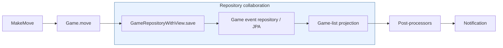
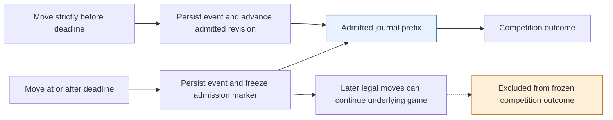
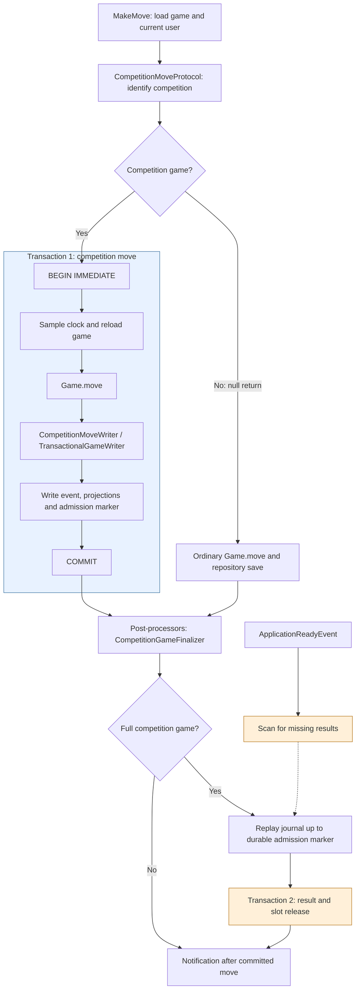
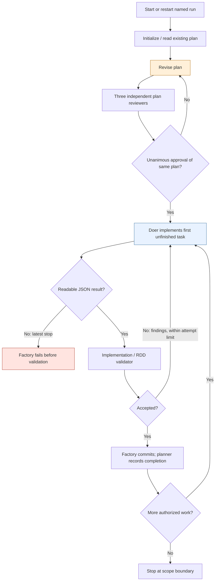
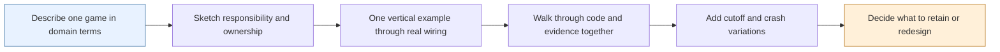

# Qubigo iteration 004: design at the point of reconsideration

Recorded 17 October 2026 for the session 7 homework log. This is a description
and discussion aid, not an approved replacement design or permission to rewrite.

The student has read the code and plan and finds them overly complicated. They
want time to consider starting again with a different approach to guiding both
implementation and design. Whether to restart, what to retain, and the alternative
approach remain open.

## Evidence and scope

This note compares three things: the established application structure, the
competition design prescribed by the run plan, and the currently inspected code.
It also describes the factory workflow that produced the change. This makes both
meanings of “current design versus current design structure” explicit.

The live application is a separate repository from this sharing repository. Its
working tree contains uncommitted task-7 changes. The local evidence is in
`factory/runs/qubigo-004/{settings.json,status,plan.md,daemon.log,record.jsonl}`;
those ignored artifacts are not published here. The plan has tasks 1–6 checked,
task 7 open, and tasks 8–18 unfinished. Its repair scope requires stopping after
task 7. Current source was inspected after the failed run; it is not a captured
source snapshot from each earlier attempt.

Shared references: [product requirements](../qubigo/docs/iterations/004-competitions.md),
[implementation claims and evidence](../qubigo/docs/iterations/004-competitions-implementation.md),
[factory workflow](../qubigo/.assembly-lines/careful-plan.md), and
[responsibility-driven design lens](../qubigo/.assembly-lines/lenses/responsibility-driven-design.md).
The implementation report contains agent claims, not independent acceptance of
the last changes. Application source is intentionally outside the sharing export.
Class names below identify the inspected source for a later walkthrough.

## Established application structure

The backend architecture guide describes feature modules with domain objects,
repository ports, commands, and adapters for HTTP, persistence and Spring wiring.
Commands coordinate work; domain objects own game rules; controllers translate
requests and responses. `QResult` represents success and failure. Games are
reconstructed from an event journal; a separate projection supplies game lists.

The ordinary move path currently reads as:

Read left to right: game behavior produces a move; the repository collaboration
saves it; successful saving allows post-processing and notification.

This gives a familiar place to look for each responsibility, although existing
framework annotations and persistence details already complicate the ideal
ports-and-adapters picture. This note does not assume the pre-competition design
was free of problems.

## What the competition plan adds

Competition lifecycle, enrollment, assignment and invitation acceptance precede
result recording. Later tasks add automatic matching, deadline closure, response
time aggregation, standings, player status, reminders and operational evidence.
The plan has 18 tasks, including human device and product review gates.

Task 7 already prescribes transaction mechanics and recovery preparation for
later closure. A competition move must acquire a SQLite write boundary before
sampling authoritative time. Its event, game-list and participant projection,
and admission marker must persist together. Only moves strictly before the
deadline advance the marker. A durable `cutoff_observed` flag prevents later
clock regression from reopening admission. Ordinary underlying play may continue
after cutoff, while competition results use only the admitted journal prefix.

Result recording is deliberately a second transaction: derive points from the
admitted prefix, store one idempotent result, and release active assignment slots.
If this fails after the move commits, recovery must retry result derivation.
Notifications follow the committed move and do not depend on result persistence.

The marker separates the underlying game's continuing history from the history
that counts for the competition. Once cutoff is observed, a regressed clock must
not allow the marker to advance again.

These are real consistency and product concerns. The open design question is
whether the chosen collaboration structure is the clearest way to express them.

## Current implementation compared with that structure

| Concern | Established structure | Current competition extension |
| --- | --- | --- |
| Move coordination | Command calls game behavior and saves through a repository | `MakeMove` optionally calls `CompetitionMoveProtocol`; a null return selects the ordinary path |
| State and time | Command loads the game and supplies a clock | `SqliteBasedCompetitionMoveProtocol` reloads the game and samples time inside `competitionWrite` |
| Persistence | Repository decorator coordinates event and list writes | Competition protocol bypasses decorator saving and calls `CompetitionMoveWriter` and `TransactionalGameWriter` |
| Transaction ownership | Framework-managed persistence around repository collaboration | Explicit `BEGIN IMMEDIATE` / commit / rollback in `CompetitionWriteBoundary`, using a transaction-bound `JdbcTemplate` |
| Completion | Normal game behavior determines board fullness | `CompetitionGameFinalizer` is a post-processor; it replays the marker-bounded journal and writes a result separately |
| Recovery | Journal reconstructs game state | Startup reconciliation scans games for missing competition results and retries finalization |
| Module coupling | Feature commands use domain ports | Games' `MakeMove` now imports the competitions protocol; Spring wiring connects both feature modules |

The competition path currently reads as:

Blue groups the atomic move writes. Orange shows the separate result write and
its recovery route. A returned result-write failure is logged by the finalizer;
the already committed move can still be notified. A rolled-back move must not
reach notification. The diagram omits exceptional exits and most read adapters.

The extra split is visible here: saving a move and recording its competition
outcome are separate durable steps, with recovery needed between them.

The protocol and finalizer are useful named concepts, but the complete behavior
is distributed across the command, protocol, writers, transaction helper,
repository decorator, marker and result ports, post-processing and Spring wiring.
Understanding a move now requires following both persistence routes and the
failure behavior between two transactions. Package conformance alone does not
make this collaboration easy to understand.

Some source comments still mention a `saveCompetitionEvent` path absent from the
inspected `SqliteBasedGameRepository`, and `CompetitionMoveWriter` retains clock
commentary although marker decisions use the event timestamp. These are concrete
signs that explanations have drifted during repair; they are not proof that the
whole design must be discarded.

## Where evidence still differs from the plan

The final doer response claimed all five latest findings resolved and passing
backend tests. The factory could not parse that Markdown response as JSON, so no
subsequent validator accepted it. Earlier reviews repeatedly found helper tests
bypassing the production wiring even when suites passed.

Inspection confirms progress: the marker UPDATE now uses conditional expressions
to preserve frozen values while still executing the update. Tests now invoke
`MakeMove`. However, the inspected full-game test constructs `MakeMove` with a
`JdbcGameRepository` and protocol, leaves post-processors at their empty default,
and asserts 27 events and board fullness. It does not establish the planned
complete-game path producing a durable competition result through the configured
finalizer. This observation is narrower than a full audit: no application tests
were rerun for this document, and other tests may cover individual collaborators.

## How implementation was guided, and why reconsider it

The `careful-plan` line uses initialization, revision, three parallel independent
plan reviewers and unanimous consensus, followed by doer/validator retries and
planner acceptance. Restarting the run repeats its start path. The external plan
has accumulated detailed SQL, wiring, test fixture and recovery instructions as
review findings were repaired. Its roughly 99 KB size is an observation at this
capture, not a measure of design quality by itself.

This shows the relevant unfinished-plan route. Plan revision and implementation
repair form different loops. Implementation attempts are bounded; plan review
continues until consensus or a stop. External-input blocking and completed-plan
shortcuts are omitted. The task-7 repair's authorized boundary is before task 8.

A plausible explanation for the student's concern is that review is increasingly
guiding implementation through local fixes to prescribed machinery, while the
end-to-end collaboration remains hard to see. The repeated production-wiring
test gap supports examining that approach. It does not establish that more
reviewers, a different model, or a rewrite would solve it.

## Questions and a possible next experiment

Before resuming implementation, describe one competition game in plain domain
terms: who owns eligibility, admission of a move, completion, and scoring? Identify
the smallest set of durable facts required at cutoff. Then compare a small number
of collaboration sketches against the existing command/domain/adapter structure.

A possible different approach is a short design walkthrough followed by one thin
vertical example: accept an invitation, play a legal full game through the real
command wiring, and record one result. Add cutoff and crash cases as explicit
variations after the basic ownership is understandable. Keep acceptance criteria
about behavior and invariants; defer SQL and class choices until the example
requires them. This is a proposal for discussion, not a selected redesign.

This is a possible learning experiment, not an approved implementation workflow.
Its purpose is to make the collaboration understandable before adding mechanics.

Preserve the current work as evidence before any restart. Decide explicitly which
requirements, accepted increments and useful code to retain. No rewrite, deletion,
run restart or application change was performed by this capture.
