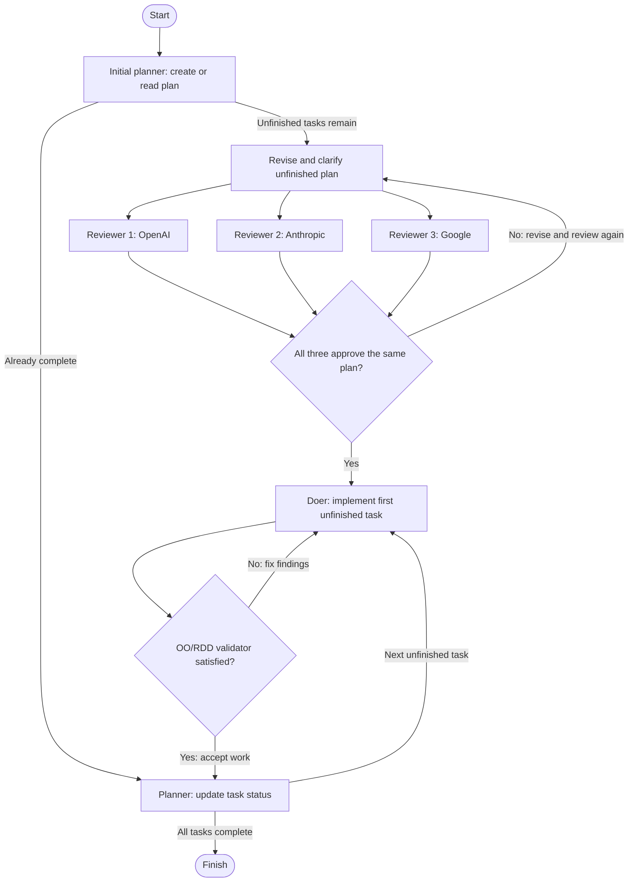

# Careful plan assembly line

This line reviews the plan with three independent models before implementation,
then validates each implemented task through an object-oriented,
responsibility-driven design (OO/RDD) lens.


[Open the full-size diagram](assets/careful-plan-process.svg).

**Initial planning:** the three brains review in parallel until they unanimously
approve the same plan. **Task execution:** the doer, validator and planner then
repeat for each task, with no return to plan review.

To view this page locally in your browser, run `bin/serve-docs` from the repository
root and open [the process page](http://localhost:8000/docs/careful-plan-process.md).

<details>
<summary>Mermaid diagram source</summary>



</details>

The three reviewers run concurrently. The consensus machine runs once after
all three finish. A dissenting reviewer sends the plan back for revision;
approval requires unanimity, rather than a majority vote.

## Machines at a glance

All nine machines use **`pi`**. **Inherited** means the machine has no `model`
override: it uses the factory run's model setting, or the harness default when
that setting is absent. Reviewer model strings below are configured identifiers.

| Machine / configuration | Model | Job | Route |
| --- | --- | --- | --- |
| [plan_initializer](#plan-initializer) | Inherited | Create or read the plan; leave tasks open. | `complete` → planner; otherwise → revision |
| [plan_revision](#plan-revision) | Inherited | Clarify unfinished tasks and consume review reports. | Fan out → all three reviewers |
| [plan_reviewer_1](#plan-reviewer-1) | `openai-codex/gpt-6-astra` | Review seed coverage, feasibility, tests and OO/RDD design. | Report → consensus |
| [plan_reviewer_2](#plan-reviewer-2) | `openrouter/anthropic/claude-opus-4.8` | Independently review the same unfinished plan. | Report → consensus |
| [plan_reviewer_3](#plan-reviewer-3) | `openrouter/~google/gemini-pro-latest` | Independently review the same unfinished plan. | Report → consensus |
| [plan_consensus](#plan-consensus) | Inherited | Require three approvals, empty findings and matching plan hashes. | `satisfied` → doer; otherwise → revision |
| [doer](#doer) | Inherited | Implement the first unfinished task; repair validation findings. | Always → validator |
| [rdd_validator](#rdd-validator) | Inherited | Validate current work against the task, seed and OO/RDD lens. | `satisfied` → planner; otherwise → doer |
| [planner](#planner) | Inherited | Mark accepted work done; select the next task or finish. | `complete` → finish; otherwise → doer |

## The two feedback loops

**Plan review:** revision → three reviewers → consensus → revision, until all
three approve the same plan. This loop runs only before implementation begins. Each reviewer writes a separate report at the
exact run plan path with `.plan_reviewer_1.json`, `.plan_reviewer_2.json`, or
`.plan_reviewer_3.json` appended. This lets the revision machine read the
findings on its next turn. Reports stay beside the run plan, outside product
commits.

**Implementation:** doer → OO/RDD validator → doer, until validation passes
or the implementation attempt limit is reached. The factory passes validation
findings to the doer's retry. On acceptance, returning to the planner causes
the factory to commit the work; the planner then marks the task done. If more
tasks remain, the planner routes directly to the doer for the next task.
Implementation and validation never route back to the three-reviewer gate.

The OO/RDD lens looks for cohesive responsibilities, behavior beside the
knowledge it needs, intention-revealing messages, narrow protocols, isolated
tests, and simple designs. Findings should identify concrete costs and small
improvements, without demanding speculative abstractions. It is copied from
[the factory validator lens](../factory/validator-lens.md).

## Machine configurations

These configurations are snapshots of the target files linked below. Expand a
machine's JSON to see its complete settings, including custom prompts and lenses.
Configuration paths are relative to `q/` (`/home/rob/dev/qubigo`).

The factory supplies the exact seed and plan paths and handles product commits.
A custom `prompt` replaces the default role instructions. For ordinary machine
calls, the factory also appends a lens, routing-field request and product diff.
The consensus join instead receives branch results and instructions to use only
those results, without reading or changing files.

### plan-initializer

**Custom prompt · inherited model.** Creates a missing plan or reads an existing one without closing tasks. Returns `complete`; a completed plan goes through `planner` to finish.

Source: [`.assembly-lines/.machines/plan_initializer/config.json`](../q/.assembly-lines/.machines/plan_initializer/config.json).

<details>
<summary>Full configuration JSON</summary>

```json
{
  "harness": "pi",
  "prompt": "You are the initial planner. If no plan exists at the designated plan path, create a plan from the seed. Otherwise read the existing plan without marking any task done. Do not implement product work. Return boolean complete true only when every task in the plan is done; otherwise return complete false, including after creating a new plan. If the designated plan cannot be read or written, report the failure and do not claim completion. This stage runs before initial parallel plan review; the regular planner handles accepted task completion afterward."
}
```

</details>

### plan-revision

**Custom prompt · inherited model.** Reads the three reports beside the exact run plan, revises unfinished tasks, then removes consumed reports. Uses the readable OO/RDD lens; preserves completed tasks and seed scope.

Source: [`.assembly-lines/.machines/plan_revision/config.json`](../q/.assembly-lines/.machines/plan_revision/config.json).

<details>
<summary>Full configuration JSON</summary>

```json
{
  "harness": "pi",
  "prompt": "Prepare the existing designated plan for independent review. Never implement product changes or mark top-level tasks done. Read any files at the exact plan path plus .plan_reviewer_1.json, .plan_reviewer_2.json and .plan_reviewer_3.json. These are reports from the preceding review round. Address all concrete findings by revising unfinished tasks in the designated plan; preserve completed tasks and seed requirements. On the first round without reports, inspect and clarify the planner's plan. Remove these three report files after consuming them so stale reports cannot leak into the next task. Make tasks small, ordered, independently verifiable and explicit about acceptance criteria and testing. Consult .assembly-lines/lenses/responsibility-driven-design.md for design guidance. Return a JSON object describing the revision."
}
```

</details>

### plan-reviewer-1

**Custom prompt · explicit OpenAI model.** Reviews the entire unfinished plan against the seed and code. Returns `satisfied`, `findings` and `plan_sha256`, and writes the same JSON to `<plan>.plan_reviewer_1.json`.

Source: [`.assembly-lines/.machines/plan_reviewer_1/config.json`](../q/.assembly-lines/.machines/plan_reviewer_1/config.json).

<details>
<summary>Full configuration JSON</summary>

```json
{
  "harness": "pi",
  "model": "openai-codex/gpt-6-astra",
  "lens": "Seed coverage, feasibility, testability and responsibility-driven object design",
  "prompt": "Independently review the entire unfinished plan at the designated plan path against the seed and the actual code. Read .assembly-lines/lenses/responsibility-driven-design.md. Check completeness, task order, feasible implementation, explicit acceptance criteria, meaningful tests, clear object responsibilities and collaborations, and unnecessary abstractions. Review the plan, not the supplied product diff. Change neither the plan nor product files. Be satisfied only when there are no concrete blocking findings. Explain each blocking finding with a specific plan location and actionable revision. Do not invent requirements or demand speculative design. Return a JSON object with boolean satisfied and array findings. Before answering, write that same JSON to the exact plan path with .plan_reviewer_1.json appended. Overwrite only your own report. Include a plan_sha256 field containing the SHA-256 of the exact plan bytes reviewed. End with that same JSON on one line."
}
```

</details>

### plan-reviewer-2

**Custom prompt · explicit Anthropic model.** Uses the same review instructions as reviewer 1 with an independent model. Writes only its own report, `<plan>.plan_reviewer_2.json`, with `satisfied`, `findings` and `plan_sha256`.

Source: [`.assembly-lines/.machines/plan_reviewer_2/config.json`](../q/.assembly-lines/.machines/plan_reviewer_2/config.json).

<details>
<summary>Full configuration JSON</summary>

```json
{
  "harness": "pi",
  "model": "openrouter/anthropic/claude-opus-4.8",
  "lens": "Seed coverage, feasibility, testability and responsibility-driven object design",
  "prompt": "Independently review the entire unfinished plan at the designated plan path against the seed and the actual code. Read .assembly-lines/lenses/responsibility-driven-design.md. Check completeness, task order, feasible implementation, explicit acceptance criteria, meaningful tests, clear object responsibilities and collaborations, and unnecessary abstractions. Review the plan, not the supplied product diff. Change neither the plan nor product files. Be satisfied only when there are no concrete blocking findings. Explain each blocking finding with a specific plan location and actionable revision. Do not invent requirements or demand speculative design. Return a JSON object with boolean satisfied and array findings. Before answering, write that same JSON to the exact plan path with .plan_reviewer_2.json appended. Overwrite only your own report. Include a plan_sha256 field containing the SHA-256 of the exact plan bytes reviewed. End with that same JSON on one line."
}
```

</details>

### plan-reviewer-3

**Custom prompt · explicit Google model.** Uses the same review instructions as reviewer 1 with an independent model. Writes only its own report, `<plan>.plan_reviewer_3.json`, with `satisfied`, `findings` and `plan_sha256`.

Source: [`.assembly-lines/.machines/plan_reviewer_3/config.json`](../q/.assembly-lines/.machines/plan_reviewer_3/config.json).

<details>
<summary>Full configuration JSON</summary>

```json
{
  "harness": "pi",
  "model": "openrouter/~google/gemini-pro-latest",
  "lens": "Seed coverage, feasibility, testability and responsibility-driven object design",
  "prompt": "Independently review the entire unfinished plan at the designated plan path against the seed and the actual code. Read .assembly-lines/lenses/responsibility-driven-design.md. Check completeness, task order, feasible implementation, explicit acceptance criteria, meaningful tests, clear object responsibilities and collaborations, and unnecessary abstractions. Review the plan, not the supplied product diff. Change neither the plan nor product files. Be satisfied only when there are no concrete blocking findings. Explain each blocking finding with a specific plan location and actionable revision. Do not invent requirements or demand speculative design. Return a JSON object with boolean satisfied and array findings. Before answering, write that same JSON to the exact plan path with .plan_reviewer_3.json appended. Overwrite only your own report. Include a plan_sha256 field containing the SHA-256 of the exact plan bytes reviewed. End with that same JSON on one line."
}
```

</details>

### plan-consensus

**Custom join prompt · inherited model.** Combines only the three branch results. Approves only when all three report `satisfied: true`, empty findings and the same nonempty hash. Returns `satisfied` and reviewer-labelled `findings`; never uses majority voting.

Source: [`.assembly-lines/.machines/plan_consensus/config.json`](../q/.assembly-lines/.machines/plan_consensus/config.json).

<details>
<summary>Full configuration JSON</summary>

```json
{
  "harness": "pi",
  "prompt": "Decide whether all three independent reviewers approve the same plan. Require exactly plan_reviewer_1, plan_reviewer_2 and plan_reviewer_3. Return satisfied true only if all three reports have satisfied exactly true, empty findings arrays and the same nonempty plan_sha256. Otherwise return satisfied false and combine all blocking findings, identifying their reviewers; include a diagnostic for missing, malformed or mismatched reports. Never override a dissenting reviewer or use majority voting. Return findings as an array, including [] on approval."
}
```

</details>

### doer

**Default doer prompt · inherited model.** Implements the first unfinished task. On retry, records validator findings as subtasks and fixes them, marking resolved subtasks done. Leaves the top-level task open for the planner. No custom prompt or lens is configured.

Source: [`.assembly-lines/.machines/doer/config.json`](../q/.assembly-lines/.machines/doer/config.json).

<details>
<summary>Full configuration JSON</summary>

```json
{
  "harness": "pi"
}
```

</details>

### rdd-validator

**Custom prompt · embedded OO/RDD lens · inherited model.** Checks current uncommitted changes against the task, seed and responsibility-driven design lens, running meaningful checks. Changes neither product nor plan. Returns `satisfied` and `findings`; acceptance requires no blocking findings. The lens is literal text embedded below, not a file path.

Source: [`.assembly-lines/.machines/rdd_validator/config.json`](../q/.assembly-lines/.machines/rdd_validator/config.json).

<details>
<summary>Full configuration JSON</summary>

```json
{
  "harness": "pi",
  "lens": "# Responsibility-driven object design\n\nReview through the object-design traditions of Sandi Metz, Rebecca Wirfs-Brock,\nDavid West, Kent Beck, and Ward Cunningham: Smalltalk-style objects collaborating\nthrough intention-revealing messages. These are influences, not claims that the\npractitioners share one fixed checklist.\n\nLook for:\n- Cohesive objects with clear responsibilities and understandable collaborators.\n- Behavior living with the object that owns the knowledge it needs; avoid exposing\n  internal state so another object can make its decisions for it.\n- Small, focused methods and meaningful names that express domain intent.\n- Collaboration through narrow protocols, rather than type switches, sprawling\n  procedural controllers, or inheritance that merely shares implementation.\n- Dependencies that permit isolated tests and changes without cascading edits.\n- The simplest design that expresses today's behavior; prefer composition and\n  useful polymorphism, but do not manufacture classes or speculative abstractions.\n\nReport concrete problems in the changed work: identify the responsibility or\ncollaboration at fault, explain its cost, and suggest a small behavioral improvement.\nJudge the current task, not an unfinished future task or the number of classes.\nDo not reject a useful function merely because it is not a method. Preserve the\nseed's behavior and the project's language idioms.\n",
  "prompt": "Validate the doer's current uncommitted product changes, including new files, against the first unfinished task, the seed and the configured responsibility-driven object-design lens. Read the designated plan and relevant code; run meaningful checks appropriate to the changed behavior. Review only this attempt, preserving existing behavior and language idioms. Report concrete defects, missing acceptance criteria or material responsibility/collaboration problems with locations and small actionable fixes. Change neither product nor plan. Return a JSON object with boolean satisfied and array findings; satisfied is true only if no blocking findings remain. Include [] when satisfied."
}
```

</details>

### planner

**Default planner prompt · inherited model.** After acceptance, the factory commits product work before invoking this machine. The default accepted-work prompt marks the first unfinished task done and returns `complete`. On entry from an already-complete initializer, its default status prompt reads the plan without changing it. No custom prompt or lens is configured.

Source: [`.assembly-lines/.machines/planner/config.json`](../q/.assembly-lines/.machines/planner/config.json).

<details>
<summary>Full configuration JSON</summary>

```json
{
  "harness": "pi"
}
```

</details>

## Files

All target paths below are relative to `q/`, which points to
`/home/rob/dev/qubigo`.

| Path | Purpose |
| --- | --- |
| `.assembly-lines/careful-plan.dot` | Authoritative runnable graph loaded by `--line careful-plan`. |
| `.assembly-lines/.machines/plan_initializer/config.json` | Initial plan creation and status instructions. |
| `.assembly-lines/.machines/planner/config.json` | Existing planner configuration for accepted task completion. |
| `.assembly-lines/.machines/doer/config.json` | Existing doer configuration. |
| `.assembly-lines/.machines/plan_revision/config.json` | Plan revision instructions. |
| `.assembly-lines/.machines/plan_reviewer_1/config.json` | OpenAI reviewer model and instructions. |
| `.assembly-lines/.machines/plan_reviewer_2/config.json` | Anthropic reviewer model and instructions. |
| `.assembly-lines/.machines/plan_reviewer_3/config.json` | Google reviewer model and instructions. |
| `.assembly-lines/.machines/plan_consensus/config.json` | Unanimous approval instructions. |
| `.assembly-lines/.machines/rdd_validator/config.json` | Implementation validation instructions and embedded lens. |
| `.assembly-lines/lenses/responsibility-driven-design.md` | Readable lens used by plan revision and reviewers. |
| `.assembly-lines/careful-plan.md` | Target-local usage notes. |

The validator's lens is embedded in its JSON configuration because the factory
treats `lens` as literal text. Keep that text and the readable lens in sync if
the lens changes. The existing assembly lines keep their configurations.

## Run it

From this factory checkout, start a new named run:

```sh
bin/factory --run qubigo-careful-plan --target q --line careful-plan --seed q/docs/iterations/002-clearer-onboarding.md
```

Choose the seed for the work you want implemented. Resume the same run with:

```sh
bin/factory --run qubigo-careful-plan
```

Run settings are immutable after creation, so use a fresh run name for a
different seed or assembly line. These commands invoke real agents. Pi needs
access to OpenAI Codex and OpenRouter; reviewer-specific models override the
shared CLI model setting.

## Limits and verification

The factory's `--max-attempts` bounds implementation attempts, not plan review
rounds. Plan review can continue indefinitely if the reviewers cannot agree;
stop the run manually in that case.

Unanimity, matching hashes, and report writing are instructions to agents,
rather than deterministic checks enforced by factory code. Structural checks
verified the JSON configurations, routing, three-branch join, reachability of
finish, and copied lens. No real-agent execution has been
performed to verify this line end to end.
