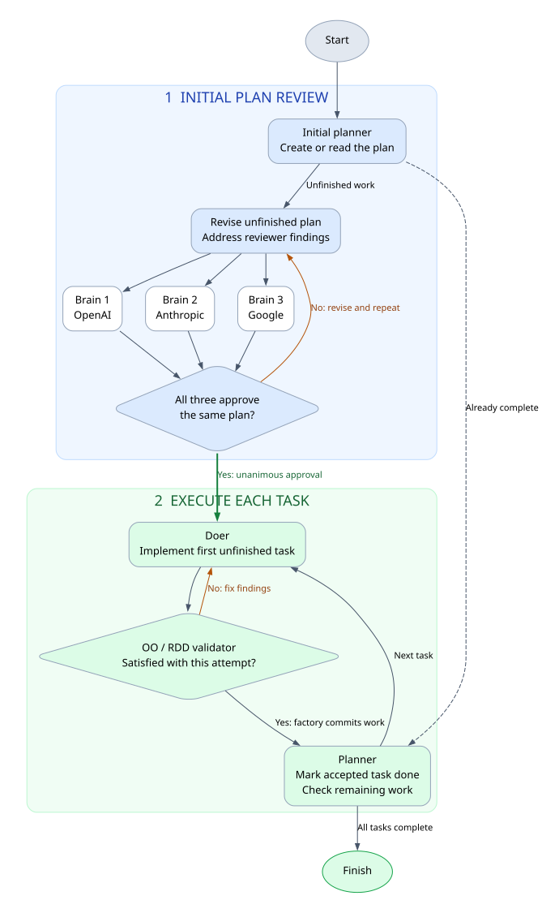
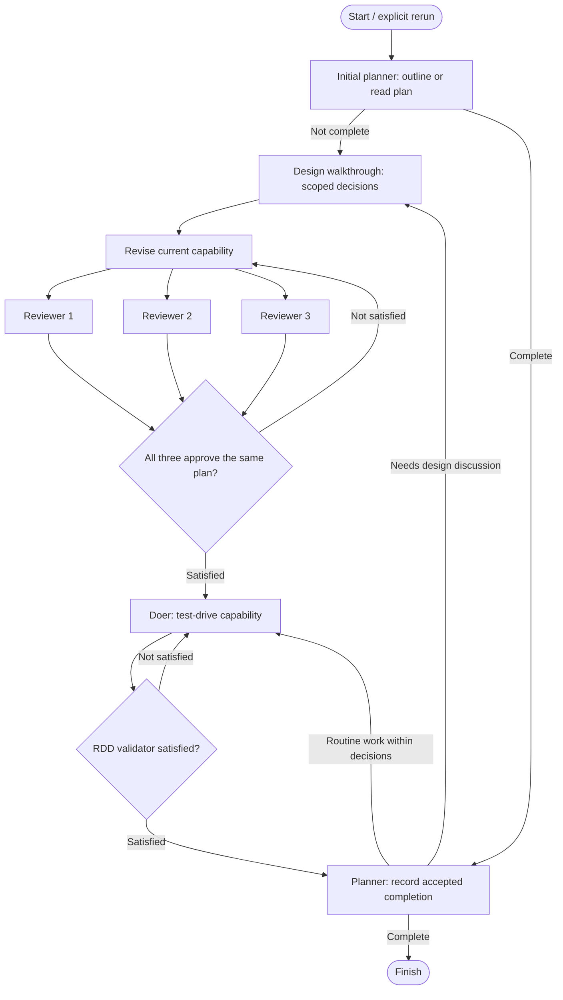

# Careful plan assembly line

**Start with a design discussion and independent plan review.** After accepted
work, routine tasks continue within those decisions. Revisit the discussion and
review gate only for genuinely new scope, context dependencies or guarantees.

Source: [live runnable graph](../q/.assembly-lines/careful-plan.dot) ·
[sharing snapshot](../qubigo/.assembly-lines/careful-plan.dot).



[Open the full-size clickable diagram](assets/careful-plan-process.svg).
The picture follows the DOT edges. Blocking is a runtime stop, not a separate
edge or a successful completion.

To view locally, run `bin/serve-docs` from the repository root and open
[the process page](http://localhost:8000/docs/careful-plan-process.md).

<details>
<summary>Mermaid diagram source</summary>



</details>

## Design discussion and blocked runs

`design_walkthrough` writes `<exact plan path>.discussion.md`: a small journey,
domain events, policies, responsibility ownership and questions about additional
guarantees or changed bounded-context dependencies. First use requires human
review. It returns `blocked: true` until initial or newly required decisions are recorded.

From Libby's root, ask Codex or pi:

> Pick up the open design discussion for run qubigo-004a.

The [discussion skill](../.agents/skills/discuss-factory-design/SKILL.md) reads the
handoff and discusses one question at a time. It records decisions; it does not
restart the factory. When ready, explicitly rerun the same named run.
**A rerun starts at `start`; it does not resume a suspended machine.** Matching,
resolved decisions are preserved and may cover multiple tasks. A new task alone
does not require another discussion.

Revision and reviewers can also block for new unagreed guarantees or context
boundaries. Parallel reviewers write their questions in their own sidecars; the
interactive session brings them into the shared discussion. The RDD validator
can block when an implementation repair requires a new design decision.

Any machine's `blocked: true` result stops before routing or acceptance of that
result. Ordinary fixable defects use the review/retry loops instead. Existing
work stays available; blocking does not mark the task complete.

## Machines at a glance

All ten machines currently use `pi`. Model identifiers below are read from the
current target configuration. “Inherited” uses the run model or harness default.

| Machine | Model | Job | Route |
| --- | --- | --- | --- |
| [plan_initializer](#plan-initializer) | `Inherited` | Create/read the overall capability outline. | Complete → planner; otherwise → design walkthrough. |
| [design_walkthrough](#design-walkthrough) | `openai-codex/gpt-6.1-sol:medium` | Prepare the initial sketch or genuinely new design questions. | Blocked → stop; resolved → revision. |
| [plan_revision](#plan-revision) | `Inherited` | Detail the current capability; consume review reports. | Fan out to three reviewers. |
| [plan_reviewer_1](#plan-reviewer-1) | `openai-codex/gpt-6-astra` | Review the unfinished plan and current capability. | Own report → consensus. |
| [plan_reviewer_2](#plan-reviewer-2) | `openrouter/anthropic/claude-opus-4.8` | Independently review the same plan. | Own report → consensus. |
| [plan_reviewer_3](#plan-reviewer-3) | `openrouter/~google/gemini-pro-latest` | Independently review the same plan. | Own report → consensus. |
| [plan_consensus](#plan-consensus) | `Inherited` | Require unanimous approval of the same plan hash. | Satisfied → doer; otherwise → revision. |
| [doer](#doer) | `Inherited` | Test-drive bounded behavior; repair ordinary defects. | Result → RDD validator. |
| [rdd_validator](#rdd-validator) | `Inherited` | Review changed behavior, design and TDD evidence. | Satisfied → planner; otherwise → doer. |
| [planner](#planner) | `Inherited` | Record completion and assess the next task against decisions. | Complete → finish; new choice → walkthrough; routine work → doer. |

## Feedback loops and acceptance

**Plan review:** revision → three concurrent reviewers → consensus → revision
until unanimous approval of the same plan hash. This gate runs initially and
when the planner identifies a new design choice requiring discussion. It does
not repeat merely because a task completed. Reviewers retain overall seed
coverage while accepting a brief outline for later work.

Each reviewer writes its own `<plan>.plan_reviewer_1.json`,
`<plan>.plan_reviewer_2.json` or `<plan>.plan_reviewer_3.json`. Reports stay beside the run
plan, outside product commits. Revision consumes ordinary reports and preserves
unresolved design questions when blocking.

**Implementation:** doer → RDD validator → doer for ordinary defects. Findings
feed the retry, bounded by `--max-attempts`. Acceptance routes to the planner:
the factory commits product work before invoking it, then the planner marks
completion. It returns both `complete` and `needs_design_discussion`.
The graph checks `complete` first: true → finish. For incomplete work,
`needs_design_discussion: false` → doer; true → walkthrough, revision and review.
The planner details routine behavior within recorded decisions; it does not
silently invent new scope or guarantees.

Plan only the next capability in detail: actor, observable outcome, relevant
rules, acceptance examples and deferrals. The doer uses TDD to discover
collaborators within the recorded architecture; it does not implement future
capabilities simply because they appear in the overall journey.

## Machine instructions and configuration

`config.json` selects harness/model. Job instructions and the RDD lens are in
machine `AGENTS.md` files, not the old inline `prompt`/`lens` JSON snapshots.
The factory supplies seed/plan paths, product changes, routing fields and prior
findings. Consensus receives branch results. Follow the links below for current
instructions and settings; these links use the sharing snapshot.

### plan-initializer

Create/read the overall capability outline.

[Instructions](../qubigo/.assembly-lines/.machines/plan_initializer/AGENTS.md) · [Configuration](../qubigo/.assembly-lines/.machines/plan_initializer/config.json)

### design-walkthrough

Prepare the initial sketch or genuinely new design questions.

[Instructions](../qubigo/.assembly-lines/.machines/design_walkthrough/AGENTS.md) · [Configuration](../qubigo/.assembly-lines/.machines/design_walkthrough/config.json)

### plan-revision

Detail the current capability; consume review reports.

[Instructions](../qubigo/.assembly-lines/.machines/plan_revision/AGENTS.md) · [Configuration](../qubigo/.assembly-lines/.machines/plan_revision/config.json)

### plan-reviewer-1

Review the unfinished plan and current capability.

[Instructions](../qubigo/.assembly-lines/.machines/plan_reviewer_1/AGENTS.md) · [Configuration](../qubigo/.assembly-lines/.machines/plan_reviewer_1/config.json)

### plan-reviewer-2

Independently review the same plan.

[Instructions](../qubigo/.assembly-lines/.machines/plan_reviewer_2/AGENTS.md) · [Configuration](../qubigo/.assembly-lines/.machines/plan_reviewer_2/config.json)

### plan-reviewer-3

Independently review the same plan.

[Instructions](../qubigo/.assembly-lines/.machines/plan_reviewer_3/AGENTS.md) · [Configuration](../qubigo/.assembly-lines/.machines/plan_reviewer_3/config.json)

### plan-consensus

Require unanimous approval of the same plan hash.

[Instructions](../qubigo/.assembly-lines/.machines/plan_consensus/AGENTS.md) · [Configuration](../qubigo/.assembly-lines/.machines/plan_consensus/config.json)

### doer

Test-drive bounded behavior; repair ordinary defects.

[Instructions](../qubigo/.assembly-lines/.machines/doer/AGENTS.md) · [Configuration](../qubigo/.assembly-lines/.machines/doer/config.json)

### rdd-validator

Review changed behavior, design and TDD evidence.

[Instructions](../qubigo/.assembly-lines/.machines/rdd_validator/AGENTS.md) · [Configuration](../qubigo/.assembly-lines/.machines/rdd_validator/config.json)

### planner

Record completion and assess the next task against decisions.

[Instructions](../qubigo/.assembly-lines/.machines/planner/AGENTS.md) · [Configuration](../qubigo/.assembly-lines/.machines/planner/config.json)

## Run or revisit a discussion

Use a fresh working branch in the live target before starting implementation.
For the prepared 004a seed, from Libby's root:

```sh
bin/factory --run qubigo-004a --target q --line careful-plan \
  --seed q/docs/iterations/004a-competitions-run-brief.md
bin/factory watch qubigo-004a
```

After discussing the blocked sketch and recording decisions, explicitly rerun:

```sh
bin/factory --run qubigo-004a
```

Run settings are fixed at creation; a different seed or line needs a fresh run
name. These commands invoke real agents; they are not executed by reading this
page. The first expected stop for a new run is its initial design discussion.
Routine task completion does not require another human stop.

## Limits and verification

The factory enforces graph routing and stops on `blocked: true`. Discussion
readiness, unanimous matching-hash approval and report writing depend on agents
following instructions; the factory does not parse discussion-file status or
independently enforce consensus semantics. `--max-attempts` bounds implementation
attempts, not plan-review rounds. Stop a non-converging review loop manually.

The graph and instruction changes passed structural checks. The full factory
suite passed, and bounded format-repair regressions cover pi print/ACP doers.
Those checks do not demonstrate the quality of human discussions or incremental
design; observe those effects during 004a. No success of that attempt is implied.

See [target workflow notes](../qubigo/.assembly-lines/careful-plan.md) and the
[short kaizen map](runs/qubigo-004/five-whys-summary.md) for the reasoning behind
these changes.
