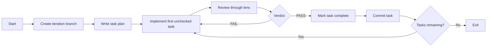

# Factory workflow

This Fabro workflow turns an iteration document into a sequence of implemented, reviewed, and committed tasks. A planner writes the task list, an implementer works on its first unchecked task, and a validator reviews the changes through a supplied lens. Only a passing review allows the workflow to complete and commit the task.

## Source files

The workflow lives in `.fabro/workflows/factory/`:

| File | Purpose |
| --- | --- |
| `workflow.toml` | Selects the graph, local environment, and default inputs. |
| `workflow.fabro` | Defines the agents, scripts, transitions, and visit limits. |
| `prompts/plan.md` | Instructs the planner to create an ordered checklist. |
| `prompts/implement.md` | Restricts implementation to the current task and handles review feedback. |
| `prompts/validate.md` | Defines the lens-based review and verdict format. |
| `scripts/route.js` | Converts review verdicts and remaining tasks into routing context. |
| `scripts/complete-task.js` | Marks the first unchecked task complete after a passing review. |

## Running it

Run from the repository root:

```bash
fabro run .fabro/workflows/factory/workflow.toml \
  -I iteration=docs/iterations/002-foo.md \
  -I lens=docs/lenses/rdd.md
```

The configured defaults are `docs/iterations/001-example.md` for the iteration and `docs/lenses/rdd.md` for the review lens. The execution environment is `local`.

The workflow requires Git, Node.js, `npx`, the configured ACP agent commands, and access to their required credentials. The implementation agent uses the repository's `.fabro/bin/pi-acp` wrapper.

## Control flow



### 1. Create the branch

The first script creates `.factory/` and runs:

```bash
git checkout -B "iteration/$(basename <iteration-path> .md)"
```

For `docs/iterations/002-foo.md`, the branch is `iteration/002-foo`. The `-B` option creates the branch or resets an existing branch of that name to the current starting commit. This step does not create an isolated worktree or clear previous `.factory/` artifacts.

### 2. Plan the iteration

The planner reads the iteration document and existing code, then writes `.factory/plan.md`. The plan contains a short summary and small, ordered, independently verifiable tasks, each written as:

```markdown
- [ ] Implement a specific behavior
```

The planner is instructed to write only the plan and make no implementation changes. Its configured command is:

```bash
ANTHROPIC_MODEL=claude-sonnet-5-5 npx -y @agentclientprotocol/claude-agent-acp
```

### 3. Implement one task

The implementer runs through `.fabro/bin/pi-acp`; the graph comments describe this wrapper as pinning Pi to DeepSeek.

It reads the iteration and plan, then implements only the first unchecked task. If `.factory/validation.md` exists, it must read and address every finding as feedback on that same task. It adds tests where sensible and runs relevant tests.

The implementer must leave the task unchecked, preserve the task order, and leave the validator's review file untouched. A failed review therefore returns to the same task rather than advancing the checklist.

### 4. Validate through the lens

The validator runs:

```bash
npx -y @agentclientprotocol/codex-acp -c model=gpt-6.1-sol
```

It reads the supplied lens first and applies its instructions to the code changes: `git diff HEAD` plus any new files. It writes `.factory/validation.md` without changing source files. The review must end with exactly one of:

```text
VERDICT: PASS
VERDICT: FAIL
```

Because the review uses the diff against `HEAD`, it includes all outstanding changes, including any unrelated changes already in the working tree.

### 5. Route the verdict

`route.js verdict` reads the final line after trimming trailing whitespace. A valid verdict produces JSON routing context:

```json
{"context_updates":{"validation_verdict":"PASS"}}
```

Both PASS and FAIL are successful script outcomes. PASS selects the conditional edge to task completion; FAIL follows the fallback edge back to implementation. Missing or malformed reviews fail the script instead of becoming ordinary review rejections.

### 6. Complete and commit the task

`complete-task.js` independently checks that the review ends in `VERDICT: PASS`. It then changes only the first checklist entry beginning with `- [ ] ` to `- [x] `. It fails if there is no unchecked task.

The commit step removes `.factory/validation.md`, stages all changes with `git add -A`, and commits with:

```text
factory: task done (<iteration-basename>)
```

The commit command includes `--allow-empty`. Since staging covers the entire working tree, unrelated changes and unignored `.factory/` files can also enter the commit. The review is removed before staging, so it is not retained as the current task's review artifact.

### 7. Continue or exit

`route.js more` checks `.factory/plan.md` for unchecked checklist lines and publishes `tasks_remaining` as a boolean. If tasks remain, execution returns to implementation. Otherwise, it exits.

Planning always leads directly to implementation; there is no empty-plan check before the first implementation attempt.

## Files and ownership

| Artifact | Writer | Role |
| --- | --- | --- |
| `.factory/plan.md` | Planner, then completion script | Ordered tasks and completion state. |
| Source and test files | Implementer | Changes for the current task. |
| `.factory/validation.md` | Validator; removed by commit step | Review and feedback for the current task. |
| Git commits | Commit script | Checkpoints after passing validation. |

Agent responsibilities are expressed in prompts. The completion script adds a deterministic check that a passing verdict exists before it updates the checklist; it does not independently prove that the implementation satisfies the task.

## Failures and limits

The graph sets `default_max_retries=0` and `max_node_visits=12`. The implementation node has its own `max_visits=10`. These bounds limit a run with many tasks or repeated failed reviews; the workflow is not an unlimited repair loop.

Planning, implementation, validation, verdict routing, task completion, and remaining-task routing explicitly specify `on_failure="exit"`. Branch creation and committing do not declare their own failure destination in this graph.

A validator's FAIL verdict is a normal routing decision, distinct from an agent or script execution failure. Failed reviews preserve the unchecked task and review feedback for the next implementation attempt. The workflow does not define a push, pull request, merge, deployment, or final acceptance stage beyond completing the task checklist.

## Script checks

The supplied tests cover verdict routing, malformed or missing inputs, remaining-task detection, and completion of only the first unchecked task after PASS. Run them from the repository root:

```bash
node --test .fabro/workflows/factory/scripts/route.test.js \
  .fabro/workflows/factory/scripts/complete-task.test.js
```
