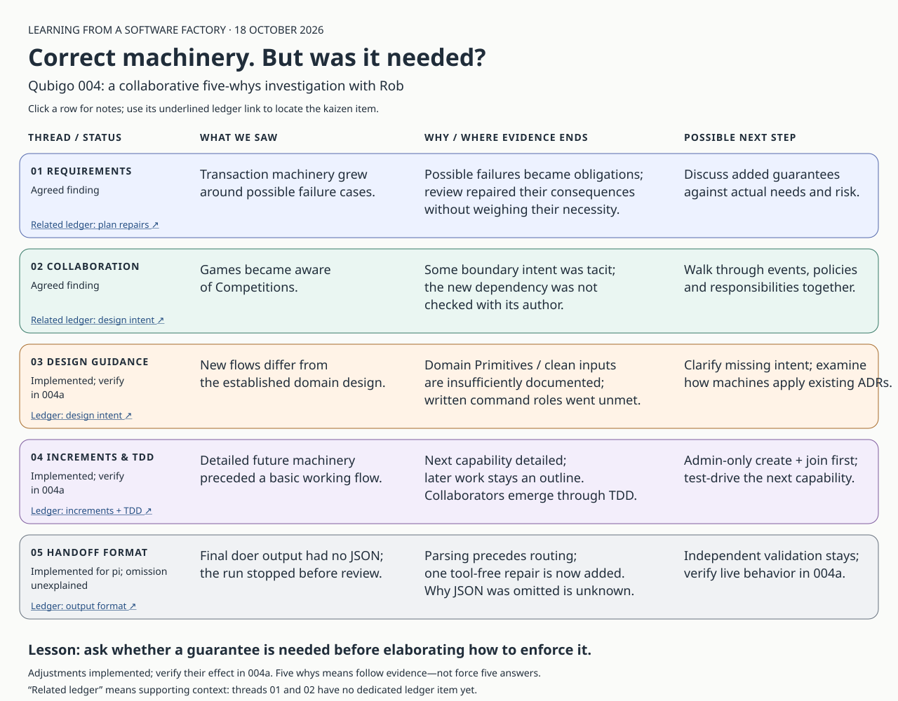

# Qubigo 004 — what we learned together

**The process checked whether machinery was correct more than whether it was needed.**

[Open the clickable picture](five-whys.html) · [Standalone SVG](five-whys-map.svg)

| Thread | Finding / evidence limit |
| --- | --- |
| Requirements | Speculative failure cases became mandatory guarantees. Repairs then generated further obligations. |
| Collaboration | Games acquired competition knowledge without checking the intended boundaries with Rob. Some intent was tacit. |
| Design guidance | Domain Primitives and clean input conversion were insufficiently explicit; documented command responsibilities were not upheld. Why enforcement failed remains open. |
| Increments and TDD | Rob would test-drive admin-only creation and joining first. Why the factory elaborated future machinery despite “small increments” instructions remains open. |
| Handoff | Missing JSON independently stopped validation. Why it was omitted is unknown; format repair remains provisional. |

**Next:** select kaizen countermeasures with Rob: clarify design intent, discuss
events/policies and added guarantees before detailed planning, and check how
machines apply existing decisions. Their effectiveness is not yet demonstrated.
No rewrite has been selected.

[Full collaborative account](collaborative-analysis.md) ·
[Kaizen ledger](../../../qubigo/docs/kaizen/README.md)

The picture has a separate underlined ledger link on every row:

| Map thread | Kaizen ledger item |
| --- | --- |
| 01 Requirements | [Related: plan repairs](../../../qubigo/docs/kaizen/README.md#plan-repairs) |
| 02 Collaboration | [Related: design intent](../../../qubigo/docs/kaizen/README.md#domain-design) |
| 03 Design guidance | [Design intent and responsibilities](../../../qubigo/docs/kaizen/README.md#domain-design) |
| 04 Increments / TDD | [Related: test design](../../../qubigo/docs/kaizen/README.md#test-design) |
| 05 Handoff format | [Prose-only output](../../../qubigo/docs/kaizen/README.md#output-format) |

“Related” marks supporting context, not a dedicated ledger item for that thread.
Threads 01, 02 and 04 do not yet have dedicated entries.

The linked picture also carries the individual discussion links. Earlier solo assessments
are provisional. We stopped causal chains where evidence ended; we did not force
five answers. This engineering pattern also occurs in human teams.
