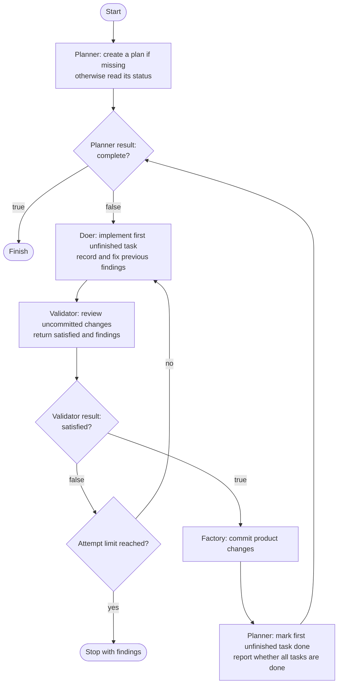
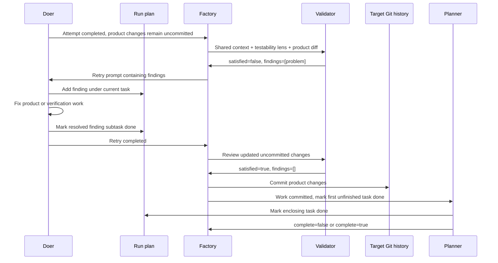

# The factory task - machine interaction

The factory controls **which machine runs next and when product work is committed**. The machines interpret the seed and plan, implement work, and make judgments. In particular, the validator decides whether an attempt is satisfactory; the doer writes validation findings into the plan as subtasks; the planner marks the accepted task done.

This document describes the current implementation, using [Qubigo's careful workflow](../q/.assembly-lines/careful.dot). Qubigo's three machine configurations select `pi`, and the validator selects the `testability` lens. None supplies a custom `prompt`, so all three use the defaults below.

## Picture of the careful workflow



The decision diamonds distinguish two kinds of decision. **The agents decide the values of `complete` and `satisfied`.** Factory code reads those booleans and follows the corresponding labelled edge. The attempt-limit decision is made directly by factory code.

The careful line is:

```dot
start -> planner
planner -> doer      [label="not complete"]
planner -> finish    [label="complete"]
doer -> validator
validator -> doer    [label="not satisfied"]
validator -> planner [label="satisfied"]
```

The doer's result does not choose a route here: its only exit always goes to the validator. A successful doer process is therefore not acceptance of its work.

## The default prompts

Every ordinary default prompt starts with `You are the <machine>.`, followed by this shared context. Paths are substituted for each run:

```text
Read the seed at "<seed>".
The plan is at "<plan>".
Read the plan at that exact path, even when it is outside the target directory.
When your job requires plan updates, write them at that exact path too.
Do not create a substitute plan inside the target.
Keep product work inside the current target directory. The factory handles commits.
End your answer with a single line of JSON.
```

For example, the saved settings for `qubigo-002` name `q/` as the target, `careful` as the line, and `q/docs/iterations/002-clearer-onboarding.md` as the seed. Its designated plan is [factory/runs/qubigo-002/plan.md](../factory/runs/qubigo-002/plan.md). This run plan is separate from the seed: the seed defines the requested scope, while the plan tracks implementation and acceptance work.

### Planner: initial entry or a resumed run

```text
If no plan exists, write one from the seed. Otherwise, report its status without changing it.
Return "complete": false while any planned product work remains, including after creating a new plan.
Return "complete": true only when every task in the plan is done.
If you cannot read or write the designated plan, report the failure; do not claim completion.
Do not implement product work.
Include boolean field "complete" in your JSON result.
```

The planner chooses the initial task breakdown. If a plan already exists, this prompt asks it to report status without rewriting it. It should return `{"complete":false}` while work remains. The factory then routes to the doer.

### Doer: every implementation attempt

```text
Implement the first unfinished task in the plan.
Validator findings from the previous attempt: <findings JSON array>
Record each finding as a subtask of the task in progress, then fix it.
Mark resolved subtasks done. Do not create new top-level tasks for findings.
Do not mark the task itself done; the planner will do that after the work is committed.
Include a JSON object describing the job you did as your result.
```

The initial findings array is `[]`. On a retry, it contains the previous validator's findings. The doer edits product files and, where needed, the designated plan. It may mark resolved subtasks done, but must leave the enclosing task unfinished.

### Validator: after each doer attempt

```text
Check the doer's uncommitted product work in this target, including new files.
Review the supplied changes only; do not recheck previously committed work.
Your validation lens is: testability.
Report findings only. Change neither the plan nor the product files.
Include boolean field "satisfied" in your JSON result. Include an array "findings" in your JSON result.
Product changes:
<current uncommitted product diff, including new files>
```

The factory supplies the changes; the validator judges them through the configured lens. The default prompt does not prescribe a severity threshold or mechanically define satisfaction. That judgment belongs to the validator agent.

For example, a rejection could be:

```json
{"satisfied":false,"findings":["The enlarged-text style persists across routes; restore it after each check and verify the next route starts at baseline."]}
```

An acceptance commonly looks like:

```json
{"satisfied":true,"findings":[]}
```

**Routing uses `satisfied`, not whether `findings` is empty.** The factory requires the validator's findings to be an array, but does not enforce consistency between that array and the boolean. A result with `satisfied: true` and nonempty findings still routes to the planner; those findings are not sent through a repair retry.

### Planner: after accepted work has been committed

Before invoking the planner on this route, the factory commits the target's product changes. It then replaces the initial planner job with:

```text
The task's work has been committed. Mark the first unfinished task done and report whether the plan is complete.
Return "complete": true only when every task in the plan is done.
Do not implement product work.
Include boolean field "complete" in your JSON result.
```

The planner now marks the accepted task done and decides whether another task remains. `complete: false` starts work on the next task; `complete: true` finishes the run.

## Who writes what?

| Participant | Product files | Designated plan | Decision or bookkeeping |
| --- | --- | --- | --- |
| Planner | Must not implement product work | Creates the initial plan; marks the first unfinished task done after acceptance and commit | Reports `complete` |
| Doer | Implements and repairs the current task | Adds each validation finding beneath the current task; marks resolved subtasks done | Reports work performed |
| Validator | Must not change them | Must not change it | Reports `satisfied` and `findings` |
| Factory code | Supplies diffs and performs commits | Does not read or edit the plan's contents | Routes results, carries findings, counts attempts |

**The doer is responsible for updating the plan based on validation details.** The validator describes the problem in JSON. The factory carries that array to the next doer prompt. The doer turns the findings into plan subtasks and fixes them. The planner closes the enclosing task only after the acceptance route and product commit.



## Why the plan expands during a run

The seed and initial plan cannot describe every defect that implementation or verification will expose. A validation finding adds concrete repair work underneath the task already in progress. This is the intended feedback loop, rather than an instruction to expand the top-level product scope.

The Qubigo run plan contains a concrete example under task 5's rendered/manual acceptance work: a validator found that an injected 200% font-size style persisted across hash routes, contaminating later baseline checks and screenshots. The plan records a nested subtask describing restoration in `finally` and assertions for baseline, enlarged, and restored sizes.

An illustrative before/after is:

```text
Before review:
- [ ] Task 5: Verify and record implementation handoff
  - [ ] Execute rendered/manual acceptance

After rejection and repair:
- [ ] Task 5: Verify and record implementation handoff
  - [ ] Execute rendered/manual acceptance
    - [x] Restore enlarged-text style after each check;
          verify subsequent routes start at baseline.

After acceptance, commit, and planner update:
- [x] Task 5: Verify and record implementation handoff
  ...
```

The saved Qubigo plan also includes findings from rendered checks and evidence collection, plus detailed command results and limitations. Not every addition is necessarily a validator finding: agents can discover problems while doing their own work. The explicit default instruction to turn **validator** findings into subtasks belongs to the doer.

The plan can therefore grow in detail while its top-level scope stays stable. New product requirements are not authorized by this retry mechanism. Already resolved findings should stay traceable; the current prompt has no explicit deduplication rule, so avoiding repeated copies of the same finding depends on the doer's interpretation of the existing plan.

## Boundaries that matter

**Acceptance and completion are agent judgments.** Factory code does not inspect plan checkboxes, prove findings were fixed, or verify that required manual acceptance really happened. It trusts the returned booleans and the agents' plan edits. The Qubigo plan illustrates why these distinctions matter: its status reports completed top-level tasks alongside outstanding physical-device and assistive-technology checks. A committed evidence report about a blocked check is not evidence that the check passed.

**Retry state lasts for the current process.** The default maximum is three doer attempts per task. A rejection at the limit stops with findings before another doer call. Attempts and carried findings reset after the planner step; they are not persisted as lifecycle state across invocations. Findings written into the plan remain available when the run resumes.

**The plan and product have separate storage.** In this example, the plan lives under `factory/runs/`, outside `q/`. Product commits are scoped to the target and exclude `.factory` and `.assembly-lines`; those commits do not capture this external run plan. The factory also calls its product-commit routine after the planner route and at normal finish, but that does not commit an external plan.

**A prompt override replaces the default role job.** Shared context and requested routing fields remain, but a custom doer prompt loses the default findings/subtask instructions; a custom planner prompt loses the initial-versus-accepted-work instructions; a custom validator prompt loses the default review restrictions and explicit findings request. The careful configurations in `q/` currently avoid this issue because they have no prompt overrides.

## Implementation references

- [Default prompts and override behavior](../factory/src/main/kotlin/MachineJobs.kt)
- [Execution loop](../factory/src/main/kotlin/FactoryRun.kt)
- [Acceptance, findings, and attempt state](../factory/src/main/kotlin/TaskLifecycle.kt)
- [Boolean routing rules](../factory/src/main/kotlin/AssemblyLine.kt)
- [Target diffs and commits](../factory/src/main/kotlin/TargetRepository.kt)
- [Qubigo careful line](../q/.assembly-lines/careful.dot) and [validator configuration](../q/.assembly-lines/.machines/validator/config.json)
- [Qubigo run settings](../factory/runs/qubigo-002/settings.json) and [saved plan](../factory/runs/qubigo-002/plan.md)

The diagrams describe the current code and intended prompt contract. The saved plan supplies examples of recorded work; it is not a complete execution trace proving every historical machine call.
